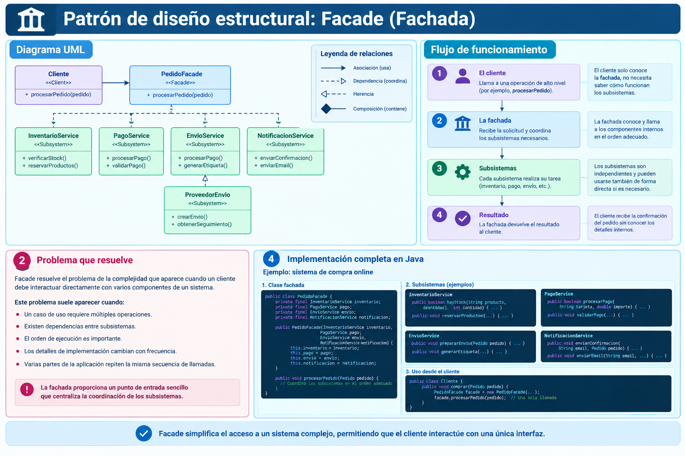
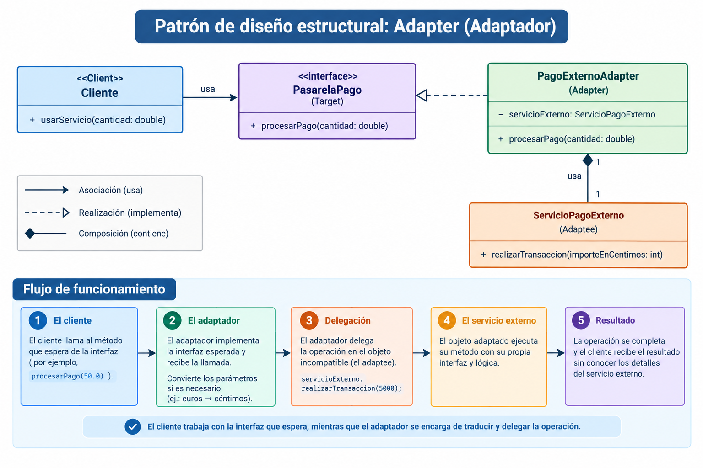
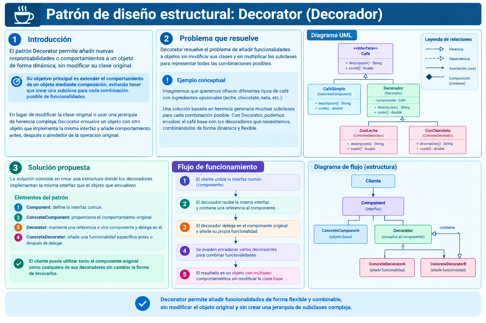
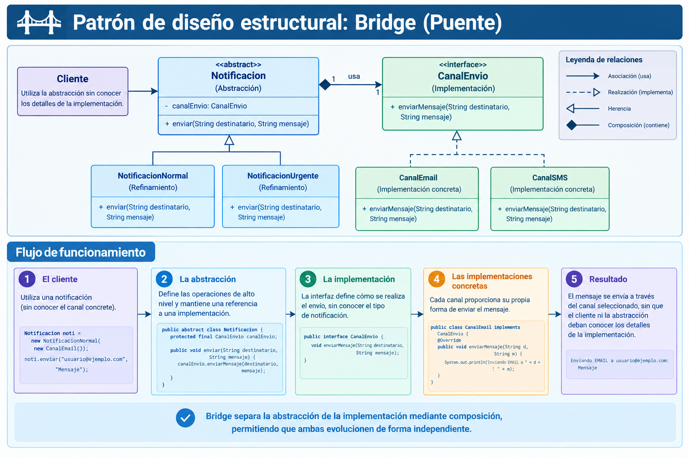

# 🏗️ Patrones de diseño

ESTE README DE NIVEL 2 CONTENDRA BREVES DESCRIPCIONES E IMAGENES.
ENLAZARA CON LOS README DE NIVEL 3 LOS CUALES DETALLARAN CON EXACTITUD LAS TECNOLOGIAS.

Los patrones de diseño son soluciones reutilizables a problemas recurrentes en la organización y colaboración de clases y objetos. Se agrupan según el tipo de problema que resuelven.

## 🏭 Patrones creacionales

Se centran en cómo se crean y configuran los objetos, reduciendo el acoplamiento entre el código cliente y los mecanismos de instanciación.

- [**Factory**](creacionales/factory/Factory_DesignPattern.md): encapsula la creación de objetos y permite delegar la elección de la instancia concreta.

- [**Builder**](creacionales/builder/Builder_DesignPattern.md): permite construir objetos complejos paso a paso, separando el proceso de construcción del resultado final.

- [**Singleton**](creacionales/singleton/Singleton_DesignPattern.md): restringe la creación de instancias de una clase a una única instancia accesible mediante un punto común de acceso.

## 🧩 Patrones estructurales
Describen cómo combinar clases y objetos para formar estructuras flexibles y simplificar sus relaciones.

Describen cómo se componen y relacionan las clases y los objetos para formar estructuras más flexibles y fáciles de mantener.

- [**Facade**](estructurales/facade/Facade_DesignPattern.md): Proporciona una interfaz simplificada para utilizar un subsistema sin exponer toda su complejidad interna.

- [**Adapter**](estructurales/adapter/Adapter_DesignPattern.md): Permite que dos interfaces incompatibles puedan colaborar mediante un adaptador que transforma una interfaz en otra. Ejemplo: adaptar una API externa a la interfaz que espera tu aplicación.

- [**Decorator**](estructurales/decorator/Decorator_DesignPattern.md): Añade responsabilidades a un objeto dinámicamente sin modificar su clase original. Ejemplo: añadir caché, registro de actividad o compresión a un servicio.

- [**Proxy**](estructurales/proxy/Proxy_DesignPattern.md): Introduce un intermediario que controla el acceso a otro objeto. Ejemplo: controlar permisos, acceso remoto o carga diferida de recursos.

- [**Composite**](estructurales/composite/Composite_DesignPattern.md): Permite tratar de manera uniforme objetos individuales y grupos de objetos organizados jerárquicamente. Ejemplo: representar carpetas y archivos mediante una estructura de árbol.

- [**Bridge**](estructurales/bridge/Bridge_DesignPattern.md): Separa una abstracción de su implementación para que ambas puedan evolucionar independientemente. Ejemplo: separar las formas de una interfaz gráfica de los motores de renderizado.

- [**Flyweight**](estructurales/flyweight/Flyweight_DesignPattern.md): Reduce el consumo de memoria compartiendo el estado común entre muchos objetos similares. Ejemplo: reutilizar datos compartidos para representar miles de elementos gráficos.

## 🔄 Patrones de comportamiento
Abordan la comunicación y la distribución de responsabilidades entre objetos, definiendo cómo colaboran para realizar determinadas operaciones.

Abordan la comunicación y la distribución de responsabilidades entre los objetos, definiendo cómo colaboran y cómo se coordinan sus acciones.

- *Esta categoría puede ampliarse con patrones como Strategy, Observer, Command, State o Mediator.*

- [**Strategy**](comportamiento/strategy/README.md): define una familia de algoritmos, encapsula cada uno y los hace intercambiables.

- [**Observer**](comportamiento/observer/README.md): define un objeto que notifica a otros objetos sobre cambios en su estado.

- [**Command**](comportamiento/command/README.md): encapsula una solicitud en un objeto, permitiendo parametrizar cualquier comando con cualquier receptor.

- [**State**](comportamiento/state/README.md): permite que un objeto cambie su comportamiento cuando su estado interno cambia.

- [**Mediator**](comportamiento/mediator/README.md): define un objeto que encapsula la comunicación entre objetos.

- [**Memento**](comportamiento/memento/README.md): permite guardar y restaurar el estado de un objeto en un momento dado.

- [**Iterator**](comportamiento/iterator/README.md): proporciona una manera de acceder a los elementos de un objeto agregado sin expone su representación interna.

- [**Chain of Responsibility**](comportamiento/chain-of-responsibility/README.md): permite pasar el control de una solicitud al siguiente receptor en una cadena de responsabilidad.

